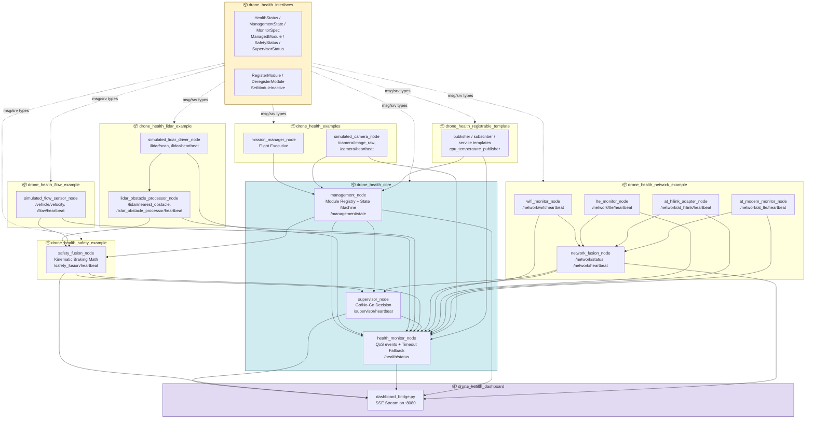
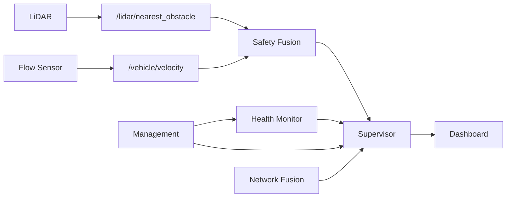

# Drone Health Monitoring Framework

[](https://docs.ros.org/)
[](https://en.cppreference.com/w/cpp/17)
[](https://www.python.org/)
[](https://github.com/ros2/rmw_zenoh)

A modular ROS 2 framework for autonomous drone health monitoring, system management, and safety supervision. It provides a closed-loop safety architecture — from sensor data ingestion to global Go/No-Go authorization — with runtime module registration, planned deregistration, and a live web dashboard.

> **Branch: `zenoh-compatibility-tests`**
> This branch makes the framework run on **`rmw_zenoh_cpp`** as well as the default DDS middleware, adds three registrable node templates plus a real CPU-temperature node, and adds tooling (a project RAG assistant and adaptation validators) for integrating new nodes. See [What's new on this branch](#-whats-new-on-this-branch).

---

##  System Architecture



---

##  Package Overview

| Package | Purpose |
|---|---|
| `drone_health_interfaces` | Shared messages and services used by all packages |
| `drone_health_core` | Core nodes: Management, Health Monitor, Supervisor |
| `drone_health_safety_example` | Safety Fusion Node — kinematic braking clearance |
| `drone_health_lidar_example` | Simulated LiDAR driver + obstacle processor |
| `drone_health_flow_example` | Simulated flow/velocity sensor |
| `drone_health_network_example` | WiFi, LTE, AT modem monitors + network fusion |
| `drone_health_examples` | Mission manager + simulated camera with deregistration |
| `drone_health_registrable_template` | Publisher, subscriber and service templates for runtime-registered modules, plus a real `cpu_temperature_publisher` |
| `drone_health_dashboard` | Web dashboard with live SSE streaming |

Non-ROS tooling at the repository root:

| Directory | Purpose |
|---|---|
| `project_agent/` | RAG assistant that answers questions about the framework and drafts adaptations of new nodes |
| `tools/` | Adaptation validators and a health-detection latency measurement script |

---

##  What's new on this branch

### 1. Zenoh middleware support

`rmw_zenoh_cpp` does not support the DDS QoS event callbacks (requested deadline missed, liveliness changed, incompatible QoS) that `health_monitor_node` uses for fast stale detection.

`health_monitor_node` now checks the active RMW at runtime via `rmw_get_implementation_identifier()`:

| RMW | Stale detection |
|---|---|
| DDS (Fast DDS, Cyclone DDS, …) | Native QoS deadline / liveliness / incompatible-QoS events **plus** the periodic timeout check |
| `rmw_zenoh_cpp` | QoS event callbacks are skipped; the **periodic timeout check** is the detection path |

On Zenoh the node logs once:

```
QoS event callbacks are disabled for this RMW; using fallback timeout monitoring
```

The fallback runs every `check_period_ms` (default 100 ms). A monitored topic whose last message is older than its `timeout_ms` is published on `/health/status` as `STALE` with reason `REASON_HEARTBEAT_TIMEOUT` (heartbeat topics) or `REASON_MESSAGE_TIMEOUT` (data topics) and the message `message timeout fallback`. Runtime-registered monitors get an extra `runtime_timeout_grace_ms` (default 500 ms).

Because of this, **every monitor must have a positive `timeout_ms`** — the node already rejects configs where it is `<= 0`. On Zenoh, detection latency is roughly `timeout_ms + check_period_ms` rather than the QoS deadline.

`drone_health_core` now depends on `rmw` (added to `package.xml` and `CMakeLists.txt`).

### 2. Registrable node templates

`drone_health_registrable_template` now ships three templates and one real node:

| Executable | Config | Use it for |
|---|---|---|
| `registrable_publisher_template_node` | `config/registrable_publisher_template.yaml` | Nodes that publish data (camera, GPS, LiDAR, battery, network) |
| `registrable_subscriber_template_node` | `config/registrable_subscriber_template.yaml` | Processing nodes: subscribe to input, publish output |
| `registrable_service_template_node` | `config/registrable_service_template.yaml` | Nodes that provide a ROS service but still need heartbeat monitoring |
| `cpu_temperature_publisher` | `config/cpu_temperature_publisher.yaml` | Real example reading `/sys/class/thermal/thermal_zone0/temp` |

Each one registers with `/management/register_module` at startup using `MonitorSpec[]`, publishes a heartbeat, and exposes a `request_deregister` service for planned shutdown. No HealthMonitor or Management YAML edits are needed. See [`src/drone_health_registrable_template/README.md`](src/drone_health_registrable_template/README.md).

### 3. Project assistant and adaptation tooling

- `project_agent/` — retrieval-augmented assistant over this repository (ChromaDB + sentence-transformers, hybrid keyword/semantic retrieval with re-ranking; Ollama, Gemini or Groq for generation).
- `tools/validate_adaptation.py` — checks a generated node adaptation against a manifest (`tools/adaptation_manifest.example.yaml`).
- `tools/validate_yolo_adaptation.py` — validator for the YOLO (`yolo_ros`) adaptation case study.
- `tools/measure_health_detection.py` — measures wall-clock time until HealthMonitor reports a topic as `STALE`; useful for comparing DDS vs Zenoh.

---

##  Build

```bash
# The repository root is the colcon workspace (packages live in src/)
git clone -b zenoh-compatibility-tests \
  https://github.com/NILAMATHI1999/drone-health-modular-framework.git ~/drone_health_modular_ws
cd ~/drone_health_modular_ws

source /opt/ros/jazzy/setup.bash
rosdep install --from-paths src --ignore-src -y
colcon build
source install/setup.bash
```

---

##  Choosing the Middleware (RMW)

### Default DDS

Nothing to do — Jazzy uses Fast DDS by default.

### Zenoh

```bash
# Install once
sudo apt install ros-jazzy-rmw-zenoh-cpp
```

Start the Zenoh router in its own terminal **before any node**:

```bash
source /opt/ros/jazzy/setup.bash
ros2 run rmw_zenoh_cpp rmw_zenohd
```

Then, in **every** terminal used below (nodes, `ros2` CLI, dashboard):

```bash
export RMW_IMPLEMENTATION=rmw_zenoh_cpp
```

All terminals must use the same RMW, otherwise nodes will not see each other. If you switch RMW, restart the ROS 2 daemon: `ros2 daemon stop`.

---

##  Complete Launch Sequence

### 0. Prerequisites (every terminal)

```bash
cd ~/drone_health_modular_ws
source /opt/ros/jazzy/setup.bash
source install/setup.bash
# Zenoh only:
# export RMW_IMPLEMENTATION=rmw_zenoh_cpp
```

All paths below are relative to the workspace (repository) root.

### 1. Core Infrastructure (Start First)

```bash
# Terminal 1: Management Node
ros2 run drone_health_core management_node --ros-args --params-file \
  src/drone_health_core/management/management.yaml

# Terminal 2: Health Monitor
ros2 run drone_health_core health_monitor_node --ros-args --params-file \
  src/drone_health_core/health_monitor/health_monitor.yaml

# Terminal 3: Supervisor
ros2 run drone_health_core supervisor_node --ros-args --params-file \
  src/drone_health_core/supervisor/supervisor.yaml
```

### 2. Sensor Layer

```bash
# Terminal 4: LiDAR Driver
ros2 run drone_health_lidar_example simulated_lidar_driver_node

# Terminal 5: LiDAR Processor
ros2 run drone_health_lidar_example lidar_obstacle_processor_node

# Terminal 6: Flow Sensor
ros2 run drone_health_flow_example simulated_flow_sensor_node \
  --ros-args -p simulate_motion:=true
```

### 3. Safety Fusion

```bash
# Terminal 7: Safety Fusion Node
ros2 run drone_health_safety_example safety_fusion_node --ros-args --params-file \
  src/drone_health_safety_example/safety_fusion/safety_fusion.yaml
```

### 4. Network Monitoring (Optional)

```bash
# Terminal 8: WiFi Monitor
ros2 run drone_health_network_example wifi_monitor_node

# Terminal 9: LTE Monitor
ros2 run drone_health_network_example lte_monitor_node

# Terminal 10: Network Fusion
ros2 run drone_health_network_example network_fusion_node

# Terminal 11: AT-HiLink Adapter
ros2 run drone_health_network_example at_hilink_adapter_node

# Terminal 12: AT Modem Monitor (Mock Mode)
ros2 run drone_health_network_example at_modem_monitor_node \
  --ros-args -p mock_mode:=true
```

### 5. Runtime-Registered Modules (Optional)

```bash
# Publisher template
ros2 run drone_health_registrable_template registrable_publisher_template_node --ros-args --params-file \
  src/drone_health_registrable_template/config/registrable_publisher_template.yaml

# Subscriber template
ros2 run drone_health_registrable_template registrable_subscriber_template_node --ros-args --params-file \
  src/drone_health_registrable_template/config/registrable_subscriber_template.yaml

# Service template
ros2 run drone_health_registrable_template registrable_service_template_node --ros-args --params-file \
  src/drone_health_registrable_template/config/registrable_service_template.yaml

# CPU temperature (real hardware reading)
ros2 run drone_health_registrable_template cpu_temperature_publisher --ros-args --params-file \
  src/drone_health_registrable_template/config/cpu_temperature_publisher.yaml

# Simulated Camera
ros2 run drone_health_examples simulated_camera_node

# Mission Manager
ros2 run drone_health_examples mission_manager_node \
  --ros-args -p start_delay_s:=5 -p inspection_duration_s:=10
```

### 6. Dashboard

```bash
ros2 run drone_health_dashboard dashboard_bridge.py
```

Open in browser: **http://localhost:8080**

---

##  Test Cases & Manual Commands

### Mission State Control

```bash
ros2 service call /management/set_mission_active std_srvs/srv/SetBool "{data: true}"
ros2 service call /management/set_mission_active std_srvs/srv/SetBool "{data: false}"

ros2 service call /management/set_maintenance_mode std_srvs/srv/SetBool "{data: true}"
ros2 service call /management/set_maintenance_mode std_srvs/srv/SetBool "{data: false}"
```

### Template Nodes — Runtime Registration & Deregistration

```bash
# Self-deregister via each template's own service
ros2 service call /template_publisher/request_deregister std_srvs/srv/Trigger "{}"
ros2 service call /template_subscriber/request_deregister std_srvs/srv/Trigger "{}"
ros2 service call /template_service/request_deregister std_srvs/srv/Trigger "{}"
ros2 service call /cpu_temperature_publisher/request_deregister std_srvs/srv/Trigger "{}"

# Operator-triggered deregistration
ros2 service call /management/deregister_module drone_health_interfaces/srv/DeregisterModule \
  "{module_name: publisher_template_node, reason: deregistered}"
```

### Camera Node — Self-Deregistration & Restore

```bash
ros2 service call /camera/request_deregister std_srvs/srv/Trigger "{}"

ros2 service call /management/deregister_module drone_health_interfaces/srv/DeregisterModule \
  "{module_name: 'camera', reason: 'deregistered'}"

ros2 service call /management/set_module_inactive drone_health_interfaces/srv/SetModuleInactive \
  "{module_name: 'camera', inactive: false, reason: 'deregistered'}"
```

### Zenoh Fallback — Stale Detection Latency

Run the stack with the camera, then:

```bash
# Terminal A: start the timer (defaults to /camera/heartbeat)
python3 tools/measure_health_detection.py /camera/heartbeat

# Terminal B: kill the camera node (Ctrl+C in its terminal)
```

The script prints the `STALE` reason, `last_update_age_s` and `wall_time_to_detect_s`. Run it once with DDS and once with `RMW_IMPLEMENTATION=rmw_zenoh_cpp` to compare QoS-event detection with the timeout fallback. On Zenoh you should also see the `fallback timeout monitoring` warning in the HealthMonitor terminal and the reason `message timeout fallback` on `/health/status`.

```bash
ros2 topic echo /health/status
```

---

## Project Assistant (`project_agent/`)

```bash
cd project_agent
python3 -m venv .venv && source .venv/bin/activate
pip install -r requirements.txt chromadb langchain-chroma

# Build the vector store from the repository
python -m app.ingest

# Ask a question
python -m app.assistant --mode explain_project \
  --input "How does HealthMonitor detect stale topics on Zenoh?"

# Draft an adaptation of a new node (validated, with automatic repair)
python -m app.assistant --mode adapt_node \
  --input "Integrate yolo_node as a registrable module" --repair-attempts 2

# Inspect the prompt and retrieved sources without calling a model
python -m app.preview_prompt --mode reuse_component --input "..."

pytest tests
```

Modes: `explain_project`, `adapt_node`, `reuse_component`. Model routing is in `config/models.yaml` (default: Ollama `llama3.2:3b` for explanations, Gemini for adaptation). Override with `--provider {ollama,gemini,groq}` and `--model`. Gemini needs `GEMINI_API_KEY`; Groq needs `GROQ_API_KEY`; Ollama expects a server at `http://localhost:11434`.

## 🛠️ Adaptation Validators (`tools/`)

```bash
# Generic: check an adapted package against a manifest
python3 tools/validate_adaptation.py <adaptation_dir> \
  --manifest tools/adaptation_manifest.example.yaml

# YOLO case study
python3 tools/validate_yolo_adaptation.py <adaptation_dir>
```

---

## Data Flow Summary



---

## License

Licenses are declared per package: `drone_health_core` and `drone_health_interfaces` declare Apache-2.0, the other packages declare MIT. Check each `package.xml` before reuse.
