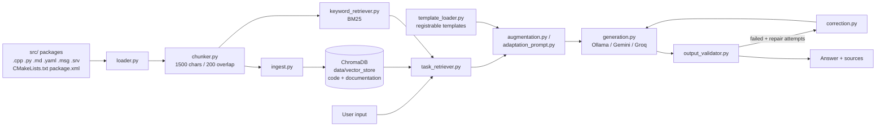

# Project Agent

A retrieval-augmented (RAG) assistant for the Drone Health Monitoring Framework. It indexes the ROS 2 packages in this repository and uses them as grounding to:

- **explain** how the framework works (`explain_project`)
- **adapt** an existing ROS 2 node so it registers with the framework (`adapt_node`)
- **reuse** framework components in another project (`reuse_component`)

Answers are generated by a local Ollama model or a hosted model (Gemini, Groq). Adaptation answers are checked by an output validator and can be repaired automatically.

---

## How it works



1. **Load** — `loader.py` walks the repository using the rules in `config/sources.yaml`. `tools/`, `project_agent/`, `build/`, `install/`, `log/` and `.git` are excluded. Each file is tagged with its package, content type and template type.
2. **Chunk** — `chunker.py` splits files with `RecursiveCharacterTextSplitter` (1500 characters, 200 overlap) and records line numbers.
3. **Embed and store** — `ingest.py` embeds chunks with `BAAI/bge-small-en-v1.5` and stores them in two ChromaDB collections (code and documentation) under `project_agent/data/vector_store/`.
4. **Retrieve** — `task_retriever.py` combines hybrid retrieval (semantic + BM25, fused with reciprocal rank fusion) with task-specific rules. For `adapt_node` it detects whether the input is a publisher, subscriber or service node and pulls the matching registrable template.
5. **Generate** — `generation.py` routes the prompt to the model configured for the task.
6. **Validate and repair** (`adapt_node` only) — `output_validator.py` checks that the answer uses the real Management services and `MonitorSpec` fields, has consistent YAML, contains an adaptation manifest, and does not contain known invented APIs. With `--repair-attempts N`, failures are sent back to the model via `correction.py`.

---

## Layout

```
project_agent/
├── app/
│   ├── assistant.py              # main CLI: retrieve → generate → validate/repair
│   ├── preview_prompt.py         # print the prompt + sources without calling a model
│   ├── ingest.py                 # build the ChromaDB vector store
│   ├── pipeline.py               # ProjectRAGPipeline: retrieval + prompt building
│   ├── loader.py, chunker.py     # read and split repository files
│   ├── embeddings.py             # BGE embeddings wrapper
│   ├── vector_store.py           # ChromaDB collections
│   ├── retriever.py              # semantic retriever
│   ├── keyword_retriever.py      # BM25 retriever
│   ├── hybrid_retriever.py       # RRF / weighted RRF / relative-score fusion
│   ├── reranking_retriever.py    # cross-encoder re-ranking
│   ├── task_retriever.py         # task-aware retrieval rules
│   ├── augmentation.py           # task modes, system rules, output contracts
│   ├── adaptation_prompt.py      # adapt_node prompt with template references
│   ├── template_loader.py        # loads drone_health_registrable_template files
│   ├── generation.py             # Ollama / Gemini / Groq clients
│   ├── ollama_stream.py          # streaming output for Ollama
│   ├── output_validator.py       # adaptation answer checks
│   ├── correction.py             # repair prompt from validation errors
│   └── evaluate_*.py             # retrieval evaluation scripts
├── config/
│   ├── sources.yaml              # which repository files are indexed
│   ├── models.yaml               # model routing per task + generation settings
│   └── retrieval_questions.yaml  # evaluation questions with expected sources
├── tests/                        # pytest unit tests
└── requirements.txt
```

---

## Requirements

- **Python 3.11+** (the code uses `enum.StrEnum`)
- One generation backend:
  - **Ollama** running at `http://localhost:11434` with the configured model pulled, or
  - a **Gemini** API key (`GEMINI_API_KEY`), or
  - a **Groq** API key (`GROQ_API_KEY`) — see the note in [Configuration](#configuration)

The first run downloads the embedding model (`BAAI/bge-small-en-v1.5`) and, for re-ranking, `cross-encoder/ms-marco-MiniLM-L6-v2` from Hugging Face.

---

## Setup

Run all commands from the `project_agent/` directory, so that the `app` package can be imported.

```bash
cd project_agent
python3 -m venv .venv
source .venv/bin/activate

pip install -r requirements.txt
# Also required by the code but not yet listed in requirements.txt:
pip install chromadb langchain-chroma rank-bm25 numpy
```

Build the vector store (re-run whenever the ROS packages change; it resets the collections):

```bash
python -m app.ingest
```

For local generation with Ollama:

```bash
ollama pull llama3.2:3b
```

For hosted models:

```bash
export GEMINI_API_KEY=...   # Gemini
export GROQ_API_KEY=...     # Groq
```

Add `project_agent/data/` and `project_agent/.venv/` to `.gitignore` so the vector store and virtual environment are not committed.

---

## Usage

### Ask about the framework

```bash
python -m app.assistant --mode explain_project \
  --input "How does HealthMonitor detect stale topics when Zenoh lacks QoS events?"
```

### Adapt a ROS 2 node

Paste the node's code or a description into `--input`. Mentioning `create_publisher`, `create_subscription` or `create_service` helps the agent pick the right template.

```bash
python -m app.assistant --mode adapt_node \
  --input "$(cat my_node.cpp)" \
  --repair-attempts 2
```

The output contains the adapted node, YAML config, CMake and `package.xml` changes, run and verification commands, an adaptation manifest, the validation report, and the source files used.

### Reuse components elsewhere

```bash
python -m app.assistant --mode reuse_component \
  --input "Reuse the HealthMonitor timeout fallback in another ROS 2 project"
```

### Options

| Option | Default | Description |
|---|---|---|
| `--mode` | required | `explain_project`, `adapt_node` or `reuse_component` |
| `--input` | required | Question or node-adaptation request |
| `--provider` | from `models.yaml` | Override provider: `ollama`, `gemini`, `groq` |
| `--model` | from `models.yaml` | Override model name |
| `--max-chunks` | `5` | Number of retrieved chunks to include |
| `--repair-attempts` | `0` | Repair rounds for failed `adapt_node` validation |

### Preview the prompt without a model

Useful for checking retrieval quality and prompt size:

```bash
python -m app.preview_prompt --mode adapt_node --input-file my_node.cpp
python -m app.preview_prompt --mode explain_project --input "What does ManagementNode do?" --max-chunks 3
```

---

## Configuration

### `config/models.yaml`

| Task | Default provider | Default model |
|---|---|---|
| `explain_project` | Ollama | `llama3.2:3b` |
| `adapt_node` | Gemini | `gemini-3.5-flash-lite` |
| `reuse_component` | Gemini | `gemini-3.5-flash-lite` |

Generation settings: `temperature: 0.1`, `context_window: 8192`, `max_output_tokens: 8192`.

> **Groq:** `generation.py` supports Groq, but `models.yaml` has no `providers.groq` entry yet. Add one before using `--provider groq`, for example:
>
> ```yaml
> providers:
>   groq:
>     base_url: "https://api.groq.com/openai/v1"
>     model: "<groq-model-name>"
> ```

### `config/sources.yaml`

Controls which files are indexed: by extension (`.cpp`, `.hpp`, `.h`, `.py`, `.md`, `.yaml`, `.yml`, `.xml`, `.msg`, `.srv`), by name (`CMakeLists.txt`, `package.xml`), and excluded directories. Re-run `python -m app.ingest` after changing it.

---

## Evaluating retrieval

`config/retrieval_questions.yaml` lists questions with the source files that should be retrieved. The evaluation scripts report where the expected sources rank:

```bash
python -m app.evaluate_semantic_retrieval      # ChromaDB similarity search
python -m app.evaluate_keyword_retrieval       # BM25
python -m app.evaluate_hybrid_retrieval        # equal RRF, weighted RRF, relative-score fusion
python -m app.evaluate_reranking               # semantic + cross-encoder, hybrid + cross-encoder
python -m app.evaluate_embeddings --model bge  # compare embedding models (bge, jina)
```

Run `python -m app.ingest` before the semantic, hybrid and re-ranking evaluations.

---

## Tests

```bash
python -m pytest tests
```

Tests cover the loader, chunker, prompt building, template loading, model selection, Ollama streaming, the output validator and the repair prompt. The test modules import the vector-store code, so the full set of dependencies from [Setup](#setup) must be installed.

---

## Validating a generated adaptation on disk

Once you have applied an adaptation to a real package, check the files with the validators in the repository's `tools/` directory (run from the repository root):

```bash
python3 tools/validate_adaptation.py <adaptation_dir> \
  --manifest tools/adaptation_manifest.example.yaml
```

---

## Limitations

- Answers are only as good as the retrieved context. Use `preview_prompt` to inspect what the model sees.
- The validator checks structure and known mistakes; it does not compile or run the generated code. Always build and test the adapted node.
- Small local models (for example `llama3.2:3b`) are suitable for explanations, but `adapt_node` works better with a larger hosted model.
